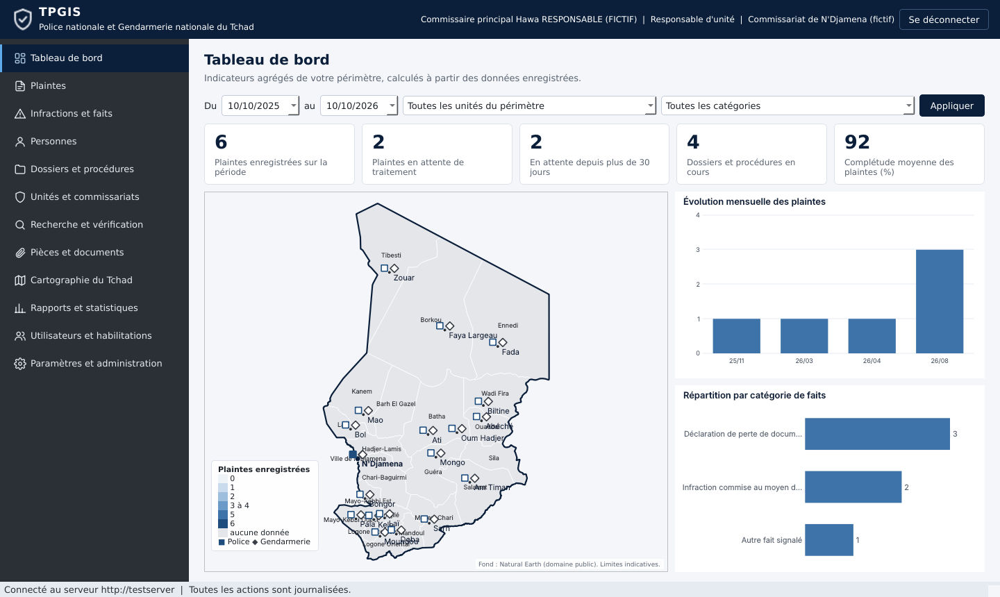

# TPGIS : Tchad Police & Gendarmerie Information System

Plateforme institutionnelle de gestion des plaintes, des faits signalés, des personnes concernées, des dossiers et procédures, des unités, des pièces jointes et des statistiques, destinée aux services habilités de la Police nationale et de la Gendarmerie nationale du Tchad.

**Statut : version 0.1.0, première version fonctionnelle soumise à validation.** Le logiciel ne doit recevoir aucune donnée réelle avant l'autorisation institutionnelle, l'audit de sécurité indépendant et les tests de restauration décrits dans [docs/conditions_mise_en_production.md](docs/conditions_mise_en_production.md).



## Ce que contient ce dépôt

| Composant | Technologie | Emplacement |
|---|---|---|
| Serveur applicatif (API sécurisée) | Python 3.12, FastAPI, SQLAlchemy 2, Pydantic 2 | `tpgis/server` |
| Migrations de base de données | Alembic (PostgreSQL 16 en production, SQLite pour les tests) | `tpgis/server/database/migrations` |
| Client de bureau Windows 10 et 11 | PySide6 (Qt 6), QSS, carte vectorielle native | `tpgis/client` |
| Éléments partagés (énumérations, permissions, schémas, données géographiques) | Python | `tpgis/shared` |
| Données de démonstration synthétiques | Générateur reproductible | `tpgis/server/database/seed` |
| Tests automatisés (114) | pytest | `tests` |
| Installateur Windows | PyInstaller et Inno Setup | `deployment/windows` |
| Déploiement serveur | systemd, nginx (TLS), nftables, PostgreSQL | `deployment/server` |
| Documentation | Markdown | `docs` |

## Démarrage rapide (démonstration locale, données fictives)

Prérequis : Python 3.12 (Windows : `py -3.12`).

```
python -m venv .venv
.venv/bin/pip install -r requirements.txt        (Windows : .venv\Scripts\pip ...)
./scripts/lancer_demo.sh                          (Windows : scripts\lancer_demo.ps1)
```

Le script génère une autorité de certification de démonstration, démarre le serveur en HTTPS sur `127.0.0.1:8443` dans l'environnement `demonstration` (base, clés et stockage séparés dans `var/demo`), charge les données synthétiques puis ouvre le client. Les comptes de démonstration sont décrits dans [docs/demonstration.md](docs/demonstration.md).

## Tests

```
pip install -r requirements-dev.txt
QT_QPA_PLATFORM=offscreen python -m pytest                       (SQLite)
TPGIS_TEST_DATABASE_URL=postgresql+psycopg://... python -m pytest (PostgreSQL, base dédiée vidée)
TPGIS_TEST_CLAMD_SOCKET=/run/clamav/clamd.ctl python -m pytest    (avec un démon ClamAV réel)
```

Résultat de la dernière exécution : 114 tests réussis sous Python 3.12.3 et 3.13 sur SQLite, et sur PostgreSQL 16.15. Le détail figure dans [docs/fonctionnalites_testees.md](docs/fonctionnalites_testees.md).

## Documentation

| Document | Contenu |
|---|---|
| [docs/architecture.md](docs/architecture.md) | Architecture, modèle de données, règles d'accès |
| [docs/deploiement_multisite.md](docs/deploiement_multisite.md) | Modèle de déploiement national multisite |
| [docs/installation.md](docs/installation.md) | Installation du serveur et des postes, ports, certificats, comptes de service |
| [docs/administration.md](docs/administration.md) | Guide d'administration et d'exploitation |
| [docs/securite.md](docs/securite.md) | Sécurité, revue de sécurité, plan de réponse aux incidents |
| [docs/sauvegarde_restauration.md](docs/sauvegarde_restauration.md) | Sauvegardes chiffrées, restauration, reprise après incident |
| [docs/guide_utilisateur.md](docs/guide_utilisateur.md) | Guide utilisateur du client de bureau |
| [docs/performances.md](docs/performances.md) | Résultats mesurés sur volumes synthétiques |
| [docs/fonctionnalites_testees.md](docs/fonctionnalites_testees.md) | Liste des fonctionnalités réellement testées |
| [docs/integrations_a_valider.md](docs/integrations_a_valider.md) | Intégrations restant à valider |
| [docs/conditions_mise_en_production.md](docs/conditions_mise_en_production.md) | Conditions juridiques et institutionnelles préalables |
| [docs/demonstration.md](docs/demonstration.md) | Environnement et comptes de démonstration |

## Principes directeurs

1. Les droits sont appliqués exclusivement côté serveur ; le client ne fait que les refléter.
2. Aucun poste client ne se connecte à la base de données ; aucune donnée n'est conservée sur les postes.
3. L'enregistrement d'une plainte ne désigne jamais un auteur reconnu ; aucune qualification automatique ni aucun score individuel n'est calculé.
4. La carte et les tableaux de bord ne présentent que des agrégats, jamais de personnes.
5. La biométrie est limitée à un adaptateur simulé sur données synthétiques, sans recherche massive, jusqu'à l'intégration d'un système institutionnel validé.
6. Toute consultation sensible exige une finalité déclarée et laisse une trace d'audit chaînée et non modifiable.
