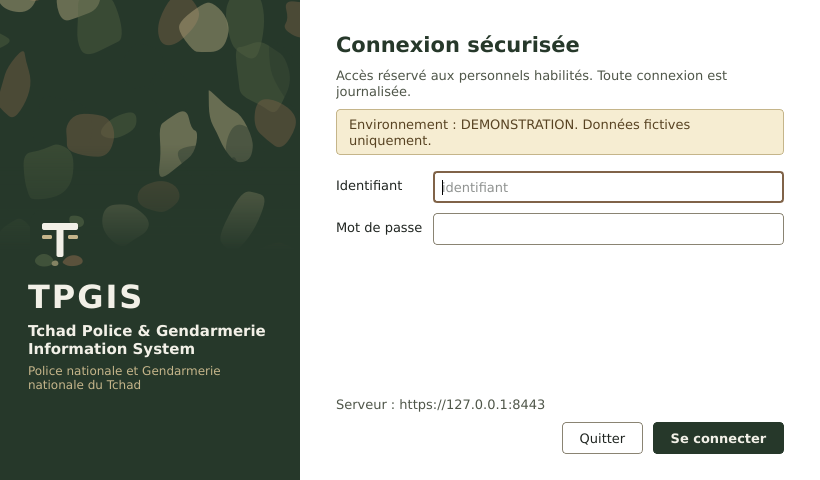
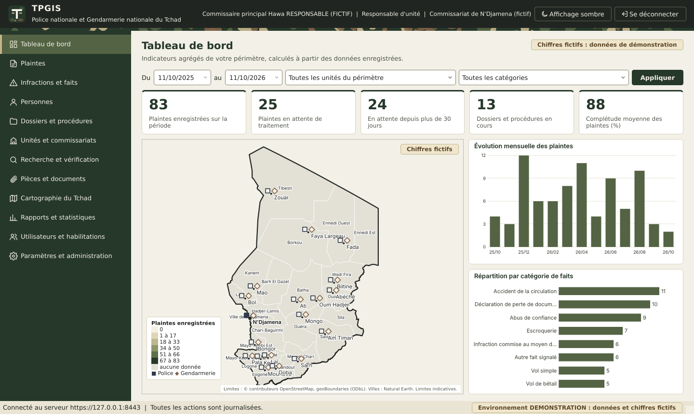
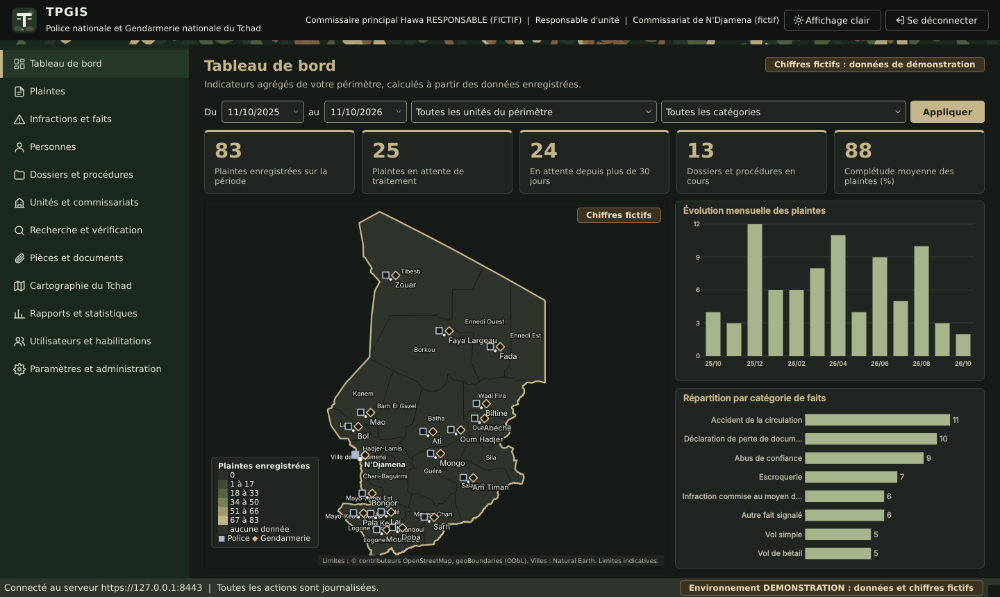

# Charte graphique du client TPGIS

La charte s'inspire des tenues bigarrées de la Gendarmerie nationale du Tchad. Elle reste institutionnelle, sobre et lisible : l'esthétique ne passe jamais avant la lisibilité. Le logiciel n'utilise aucun emblème officiel, insigne, grade ni logo institutionnel.



## 1. Palette de référence

| Nom | Valeur | Usage principal |
|---|---|---|
| Vert olive profond | `#26382A` | Navigation latérale, boutons principaux, titres, couverture des rapports |
| Vert kaki | `#536344` | Élément de navigation sélectionné, survol des boutons, séries des graphiques |
| Sable militaire | `#C5B58A` | Indicateur de sélection, accents sur fond sombre, action principale du thème sombre |
| Brun terre | `#806348` | Contour de focus, unités de gendarmerie sur la carte, hausses sur la carte de tendance |
| Anthracite tactique | `#202521` | Texte courant, bandeau supérieur, frontière nationale sur la carte |
| Ivoire clair | `#F2F0E7` | Fond de l'application, texte sur fonds foncés |

Ces six valeurs sont définies une seule fois dans `tpgis/shared/charte.py`, partagé par le client et par le serveur (documents PDF).

## 2. Système de thèmes

Toutes les couleurs, espacements, rayons et tailles sont centralisés dans `tpgis/client/theme/jetons.py` sous forme de **jetons sémantiques** (par exemple `navigation_fond`, `texte_secondaire`, `carte_frontiere`). Aucun autre fichier du client ne contient de couleur : un test automatique le vérifie.

| Élément | Fichier | Rôle |
|---|---|---|
| Jetons | `tpgis/client/theme/jetons.py` | Thèmes clair et sombre, espacements (4, 8, 12, 16, 24 px), rayons (4 et 6 px), tailles de police |
| Feuille de style | `tpgis/client/resources/styles/tpgis.qss` | Modèle QSS sans aucune couleur ; chaque jeton entre doubles accolades est remplacé à l'application du thème |
| Gestionnaire | `tpgis/client/theme/gestionnaire.py` | Rendu du QSS, palette Qt cohérente (boîtes de message, menus, calendriers), icônes colorées, notification des changements |
| Identité | `tpgis/client/theme/identite.py` | Nom, sous titre et logo configurables |
| Motif bigarré | `tpgis/client/theme/bigarre.py` et `tpgis/shared/charte.py` | Panneau de connexion, liseré du bandeau, couverture des rapports |

Les composants dessinés (carte, graphiques, liseré) lisent le thème actif au moment du dessin et se redessinent quand l'utilisateur change d'affichage, sans redémarrage.

### 2.1 Affichage clair (par défaut) et affichage sombre

| Affichage clair | Affichage sombre |
|---|---|
|  |  |

L'affichage clair est utilisé par défaut. L'affichage sombre est destiné aux postes qui le nécessitent (pièces peu éclairées, permanences de nuit). Le choix se fait :

1. par l'utilisateur, avec le bouton « Affichage sombre » ou « Affichage clair » du bandeau supérieur (choix mémorisé sur le poste) ;
2. par l'administration, avec `theme = clair` ou `theme = sombre` dans la section `[affichage]` de `client.ini` (valeur par défaut du poste).

### 2.2 Composants

| Composant | Règle |
|---|---|
| Police | Segoe UI (police système de Windows 10 et 11), 10 points pour le texte courant |
| Navigation latérale | Fond vert olive, élément sélectionné en vert kaki avec un indicateur sable à gauche |
| Bandeau supérieur | Fond anthracite, nom et logo du logiciel, identité de l'utilisateur, liseré bigarré de 6 pixels en dessous |
| Cartes d'indicateurs et panneaux | Fond blanc, bordure fine, coins arrondis de 6 pixels, filet supérieur vert olive |
| Tableaux | Fond blanc, lignes alternées ivoire très pâle, en têtes sable pâle ; jamais de motif |
| Boutons | Bouton principal vert olive (sable dans l'affichage sombre), boutons secondaires sur fond blanc, contour de focus brun terre de 2 pixels |
| Champs de saisie | Fond blanc, bordure contrastée (au moins 3:1), champ obligatoire signalé par un filet vert olive à gauche |
| Icônes | Bibliothèque unique de pictogrammes linéaires (grille de 24 pixels, trait de 1,8), colorés par le thème |

## 3. Motif bigarré

Le motif est composé de formes irrégulières vert olive, kaki, sable et brun, générées de façon déterministe (le même motif à chaque affichage). Il est **discret** : opacité réduite sur fond olive.

| Emplacement autorisé | Traitement |
|---|---|
| Écran de connexion | Panneau latéral gauche ; le motif s'efface vers une zone unie où figurent seulement le logo et le nom du logiciel |
| Bandeaux décoratifs | Liseré de 6 pixels sous le bandeau supérieur |
| Couvertures de rapports | Bandeau de 3,2 cm en haut de la première page du rapport statistique PDF |

Le motif n'est **jamais** placé derrière un formulaire, un tableau, une donnée personnelle ou un chiffre. Les champs de l'écran de connexion sont sur une surface unie, séparée du panneau décoratif ; un test automatique vérifie qu'aucun champ de saisie n'est contenu dans un composant bigarré.

## 4. Accessibilité

Les contrastes sont vérifiés automatiquement selon WCAG 2.1 pour les deux affichages (`tests/client/test_charte_graphique.py`) :

| Élément | Seuil exigé |
|---|---|
| Texte courant, texte secondaire, titres, texte des boutons, navigation, messages d'erreur et d'avertissement, info bulles | 4,5:1 |
| Bordures des champs, contour de focus, séries des graphiques, frontière et marqueurs de la carte | 3:1 |

Le focus clavier est toujours visible (contour de 2 pixels). La couleur n'est jamais le seul porteur d'information : les statuts sont écrits en toutes lettres, les marqueurs de la carte diffèrent aussi par leur forme (carré pour la police, losange pour la gendarmerie), et les noms sur la carte sont entourés d'un halo de la couleur du fond.

## 5. Carte du Tchad

La carte du tableau de bord et du module de cartographie est dessinée à partir des données géographiques embarquées (`tpgis/shared/geodata`), vérifiées par un test automatique :

1. l'empreinte SHA 256 de chaque fichier correspond à celle consignée dans `SOURCES.json` ;
2. les 23 provinces correspondent exactement aux codes ISO 3166-2:TD du découpage de 2018 ;
3. toutes les coordonnées sont comprises dans l'emprise du Tchad ;
4. N'Djamena est située dans la province TD-ND et Abéché dans le Ouaddaï (TD-OD).

Les limites proviennent de geoBoundaries (OpenStreetMap, licence ODbL) et restent indicatives tant que l'administration territoriale n'a pas fourni de limites officielles (voir [integrations_a_valider.md](integrations_a_valider.md)). La palette de la carte va de l'ivoire au vert olive ; la carte de tendance utilise le vert pour les baisses et le brun terre pour les hausses.

## 6. Chiffres fictifs

Hors production (environnements de test et de démonstration), tous les chiffres sont identifiés comme fictifs :

| Emplacement | Mention |
|---|---|
| Tableau de bord, cartographie, rapports | Pastille « Chiffres fictifs : données de démonstration » à côté du titre |
| Carte | Pastille « Chiffres fictifs » dans l'angle supérieur droit |
| Barre d'état | « Environnement DEMONSTRATION : données et chiffres fictifs » en permanence |
| Écran de connexion | Bandeau d'avertissement de l'environnement |
| Rapport statistique PDF | Encadré « DONNÉES FICTIVES » en tête du document |

En production, ces mentions n'apparaissent pas.

## 7. Nom et logo du logiciel

Le logo fourni est un monogramme neutre (`tpgis/client/resources/icons/logo_tpgis.svg`) qui ne reproduit aucun emblème, insigne ni symbole officiel. Le nom et le logo sont configurables dans la section `[identite]` de `client.ini` :

```
[identite]
nom = TPGIS
nom_complet = Tchad Police & Gendarmerie Information System
sous_titre = Police nationale et Gendarmerie nationale du Tchad
logo = C:\TPGIS\identite\logo.svg
```

Un emblème ou un logo institutionnel ne doit être indiqué qu'après autorisation formelle de l'institution. L'icône de l'exécutable Windows (`tpgis.ico`) est produite à partir du logo par défaut ; elle se remplace au moment de la construction de l'installateur.

## 8. Captures

Les captures de ce document et de la galerie (`docs/captures/galerie_interfaces.pdf`) sont produites par `scripts/captures_interfaces.py` sur des données entièrement fictives.
