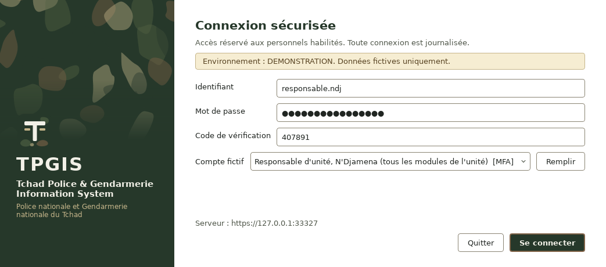

# Fonctionnalités réellement testées

Ce document distingue ce qui a été **exécuté et vérifié** de ce qui ne l'a pas été. Toutes les vérifications ont utilisé des données synthétiques.

## 1. Exécutions de référence (10 octobre 2026)

| Campagne | Environnement | Résultat |
|---|---|---|
| Suite complète sur SQLite, après la charte graphique et l'exécutable de démonstration (11 octobre 2026) | Python 3.13.16, Linux | 143 tests réussis, 1 ignoré (démon ClamAV réel non fourni pour cette exécution) |
| Suite complète sur SQLite | Python 3.13.16, Linux | 121 tests réussis (avec démon ClamAV réel) |
| Suite complète sur PostgreSQL 16.15 | Python 3.13.16, Linux | 121 tests réussis |
| Suite complète sur SQLite, dépendances verrouillées | Python 3.12.3, Linux | 121 tests réussis |
| Linter et règles de sécurité (Ruff, sous ensemble Bandit) | Python 3.13 | Aucun écart |
| Audit des dépendances (`pip-audit`) | requirements-dev.txt | Aucune vulnérabilité connue |
| Performances sur 200 000 plaintes et 100 000 personnes | PostgreSQL 16.15 | Voir [performances.md](performances.md) |

Commande : `QT_QPA_PLATFORM=offscreen python -m pytest` (ajouter `TPGIS_TEST_DATABASE_URL` pour PostgreSQL et `TPGIS_TEST_CLAMD_SOCKET` pour ClamAV).

## 2. Correspondance avec les tests obligatoires du cahier des charges

| Exigence | Tests automatisés |
|---|---|
| Création d'une plainte | `test_creation_plainte_numero_unique_et_statut_initial`, `test_creation_avec_personnes_et_roles`, `test_parcours_enregistrement_plainte` (interface) |
| Modification d'un dossier | `test_modification_avec_controle_de_version`, `test_modification_dossier_et_actes`, `test_cloture_exige_motif_et_habilitation`, `test_transitions_interdites_et_transmission` |
| Recherche par numéro | `test_recherche_par_numero`, `test_separation_des_donnees_entre_unites` (numéro hors périmètre non révélé) |
| Détection de doublons | `test_detection_doublons_et_validation_humaine`, `test_homonymie_seule_ne_cree_pas_de_correspondance_forte`, `test_score_doublons_multi_attributs`, `test_fusion_soumise_a_double_validation` |
| Contrôles d'accès | `tests/security/test_controle_acces.py` (21 tests), `test_navigation_filtree_selon_les_droits` |
| Séparation des données entre unités | `test_separation_des_donnees_entre_unites`, `test_creation_pour_une_autre_unite_refusee`, `test_responsable_voit_unites_subordonnees`, `test_enqueteur_limite_aux_dossiers_attribues`, `test_carte_agregats_par_province_et_filtres` |
| Révocation d'un compte | `test_desactivation_revoque_immediatement`, `test_revocation_administrative_des_sessions` |
| Validation des fichiers | `test_extension_et_signature_controlees`, `test_taille_maximale_configurable`, `test_fichier_infecte_jamais_disponible`, `test_signatures_valides`, `test_signatures_invalides`, `test_demon_clamd_reel`, `test_antivirus_indisponible_piece_bloquee` |
| Journalisation des consultations sensibles | `test_consultation_sensible_journalisee_avec_finalite`, `test_recherche_journalisee`, `test_refus_journalises`, `test_journal_sans_secret` |
| Sauvegardes et restaurations | `test_sauvegarde_puis_restauration`, `test_sauvegarde_alteree_refusee`, `test_restauration_refusee_dans_un_autre_environnement`, `test_chiffrement_par_blocs_aller_retour` |
| Erreurs réseau | `test_serveur_injoignable`, `test_delai_depasse`, `test_certificat_non_reconnu_refuse`, `test_erreurs_api_traduites` |
| Gestion des sessions | `test_connexion_et_deconnexion`, `test_expiration_et_inactivite`, `test_jeton_stocke_sous_forme_d_empreinte`, `test_changement_mot_de_passe_obligatoire`, `test_enrolement_mfa_exige_pour_nouveau_compte_privilegie`, `test_operation_critique_exige_reauthentification` |
| Migration de la base de données | `test_migration_montee_et_descente`, `test_schema_conforme_aux_modeles` |
| Tests négatifs par appel direct de l'API | `test_acces_sans_authentification_refuse`, `test_jeton_invente_refuse`, `test_admin_technique_sans_acces_aux_dossiers`, `test_admin_fonctionnel_sans_acces_aux_donnees_operationnelles`, `test_agent_accueil_sans_biometrie`, `test_auditeur_ne_peut_pas_modifier`, `test_consultation_seule_ne_peut_pas_ecrire`, `test_recherche_nationale_reservee`, `test_injection_sql_inoperante`, `test_elevation_privileges_par_attribution_role_refusee` |

## 3. Autres fonctionnalités vérifiées

| Fonctionnalité | Vérification |
|---|---|
| Force brute (mot de passe, code MFA, confirmation d'identité) | `test_verrouillage_apres_echecs_repetes`, `test_codes_mfa_errones_verrouillent_le_compte`, `test_reauthentification_par_force_brute_bloquee`, `test_limitation_debit_connexion`, `test_message_identique_compte_inconnu` |
| MFA, anti rejeu, secret chiffré | `test_mfa_obligatoire_pour_compte_privilegie`, `test_rejeu_code_mfa_refuse`, `test_totp_anti_rejeu`, `test_secret_totp_chiffre_au_repos` |
| Chiffrement au repos, rotation, index aveugle | `test_chiffrement_aller_retour_et_rotation`, `test_alteration_detectee`, `test_index_aveugle_normalise`, `test_depot_et_telechargement_avec_integrite` |
| Journal d'audit chaîné et immuable | `test_chaine_integre_puis_alteration_detectee`, `test_journal_non_modifiable`, `test_changement_de_droits_journalise` |
| Versions de pièces et contrôle d'accès par dossier | `test_versions_et_acces_selon_dossier` |
| Biométrie simulée (1 pour 1, finalité, recherche désactivée) | `test_biometrie_simulee_verification_un_pour_un`, `test_biometrie_exige_finalite`, `test_suppression_capture_double_validation` |
| Faits : nature de l'information, absence de score | `test_fait_decision_judiciaire_exige_reference` |
| Référentiel des catégories administrable | `test_categories_administrables_sans_code` |
| Statistiques exactes et sans données nominatives | `test_tableau_de_bord_calcule_sur_donnees_reelles`, `test_statistiques_sans_donnees_nominatives`, `test_seuil_de_confidentialite` |
| Exports réservés et tracés, CSV neutralisé | `test_exports_reserves_et_traces`, `test_cellules_csv_neutralisees` |
| Documents PDF (fiche, bordereau, rapport) | `test_fiche_et_bordereau_pdf`, `test_exports_reserves_et_traces` |
| Pagination et validation des entrées | `test_pagination`, `test_validation_entrees` |
| Garde fous de production et séparation des environnements | `tests/unit/test_configuration.py` |
| Interface : 13 modules chargés pour 5 rôles, sans erreur | `test_toutes_les_pages_se_chargent` |
| Interface : carte alimentée (23 provinces dont Ennedi Est et Ennedi Ouest, unités), indicateurs | `test_tableau_de_bord_et_carte_alimentes` |
| Interface : erreurs serveur affichées dans le formulaire | `test_formulaire_affiche_erreur_serveur` |
| Charte graphique : palette de référence, jetons identiques dans les deux thèmes, feuille QSS entièrement résolue | `test_palette_de_reference_de_la_charte`, `test_les_deux_themes_definissent_les_memes_jetons`, `test_feuille_de_style_entierement_resolue` |
| Charte graphique : contrastes WCAG 2.1 (4,5:1 pour le texte, 3:1 pour les composants) dans les affichages clair et sombre | `test_contrastes_wcag`, `test_contraste_calcule_selon_wcag` |
| Charte graphique : aucune couleur codée en dur hors du système de thèmes, icônes cohérentes | `test_aucune_couleur_codee_en_dur_hors_du_systeme_de_themes`, `test_icones_vectorielles_coherentes` |
| Charte graphique : bascule clair et sombre à chaud (palette, carte, bandeau), sans erreur après fermeture des fenêtres | `test_bascule_clair_sombre_a_chaud`, `test_changement_de_theme_sans_erreur_apres_destruction_des_composants`, `test_theme_inconnu_retombe_sur_le_theme_clair` |
| Motif bigarré déterministe, limité à la palette, jamais derrière un formulaire | `test_motif_bigarre_discret_deterministe_et_dans_la_palette`, `test_motif_jamais_derriere_les_formulaires` |
| Chiffres signalés fictifs hors production (interface et rapport PDF), absents en production | `test_chiffres_signales_fictifs_hors_production`, `test_rapport_pdf_couverture_et_mention_fictive` |
| Nom et logo du logiciel configurables, logo par défaut sans emblème | `test_nom_et_logo_configurables`, `test_logo_par_defaut_sans_embleme_officiel` |
| Carte du Tchad : empreintes des données, 23 codes ISO 3166-2:TD, emprise, localisation de N'Djamena et d'Abéché | `test_donnees_geographiques_verifiees` |

## 4. Vérifications manuelles réalisées

| Vérification | Résultat |
|---|---|
| Serveur en HTTPS (certificats de démonstration), client avec l'autorité de l'institution | TLS 1.3 négocié ; connexion refusée sans l'autorité |
| Parcours client réel asynchrone en TLS : connexion, MFA, tableau de bord, plaintes, carte, recherche | Réussi, captures dans `docs/captures` |
| Script de démonstration complet `scripts/lancer_demo.sh` | Réussi jusqu'à l'ouverture du client |
| Outil `tpgis-admin` sur PostgreSQL : initialisation, chargement, sauvegarde, vérification, restauration, vérification d'audit | Réussi |
| Construction de l'exécutable PyInstaller (sous Linux, pour valider le fichier de construction) | Réussi : ressources et carte embarquées, aucun composant serveur inclus, démarrage constaté |

## 5. Ce qui n'a PAS été exécuté dans cet environnement

1. **Windows 10 et 11 réels** : l'exécutable et l'installateur ont été construits et exécutés sous Wine 9 (voir le paragraphe 6), pas sur des postes Windows réels. Un essai sur les postes types du parc reste à faire, notamment la mise à l'échelle des écrans haute densité et la signature de code.
2. **Le fond de carte raster en ligne** (couche de tuiles) n'a pas été essayé avec un fournisseur réel.
3. **ClamAV avec les signatures officielles** : le démon réel a été testé avec une signature locale EICAR, le téléchargement des signatures officielles étant bloqué dans l'environnement de développement.
4. **Le déploiement systemd, nginx et nftables** n'a pas été exécuté sur un serveur cible ; les fichiers sont fournis comme modèles.
5. **La saisie au clavier et à la souris** de l'interface n'a pas été éprouvée par des utilisateurs ; les tests pilotent les composants par programme.
6. **La charte graphique dans l'exécutable Windows** : la nouvelle charte (thèmes clair et sombre, motif, logo) a été vérifiée par les tests et les captures sous Linux ; l'exécutable et l'installateur n'ont pas encore été reconstruits et réessayés sous Wine avec elle. Les captures `windows_*.png` montrent la charte précédente.
7. **Les performances en réseau réel** (latence, TLS, plusieurs postes simultanés) restent à mesurer sur l'infrastructure cible.

## 6. Construction et exécution Windows sous Wine (11 octobre 2026)

Banc d'essai : Linux, Wine 9.0, Python 3.12.10 officiel pour Windows, dépendances verrouillées, PyInstaller 6.22.3, Inno Setup 6.7.3.

| Étape | Résultat |
|---|---|
| Construction de `TPGIS.exe` avec `deployment/windows/tpgis_client.spec` | Réussie, sans avertissement : exécutable PE32+ x86-64 graphique, 96 Mo, extensions Qt embarquées |
| Compilation de l'installateur avec `installateur.iss` | Réussie : `TPGIS_Client_0.1.0_Installation.exe`, 29 Mo |
| Installation silencieuse (`/VERYSILENT /TASKS=bureau`) | Programme dans `Program Files\TPGIS`, `client.ini` contenant l'adresse fournie à la compilation, raccourcis bureau et menu Démarrer |
| Lancement, serveur injoignable | Message explicite « Serveur indisponible », arrêt propre |
| Lancement, `client.ini` pointant vers le serveur de démonstration TLS | Certificat vérifié avec l'autorité indiquée, connexion d'un agent d'accueil, menu réduit à ses 6 modules |
| Parcours complet au clavier simulé (identifiant, mot de passe, code MFA) | Tableau de bord alimenté, carte à 23 provinces, liste des plaintes paginée |
| Désinstallation silencieuse | Programme et raccourcis supprimés ; `client.ini` conservé comme prévu |

Deux fonctions de Windows absentes de Wine 9 ont dû être simulées **uniquement sur le banc d'essai** (jamais dans la livraison) : la bibliothèque ICU du système (`icuuc.dll`, redirigée vers ICU 78) et quatre fonctions de profils de couleur (`mscms.dll`). Ces composants sont présents nativement sur Windows 10 (version 1703 et suivantes) et Windows 11.

Défauts trouvés et corrigés grâce à ce banc : extensions Qt non garanties dans l'exécutable (désormais collectées explicitement), barres d'actions tronquées à la taille minimale de fenêtre (réorganisées, test automatique ajouté), étiquettes de mois superposées sur le graphique, absence du bandeau d'environnement de démonstration, message d'erreur de proxy peu explicite.

## 7. Exécutable de démonstration en un clic (11 octobre 2026)

Banc d'essai identique au paragraphe 6 (Wine 9, Python 3.12.10 pour Windows, PyInstaller 6.22.3), dépendances du client et du serveur verrouillées.

| Étape | Résultat |
|---|---|
| Construction de `TPGIS_Demonstration.exe` avec `deployment/windows/tpgis_demonstration.spec` | Réussie : un seul fichier PE32+ x86-64 graphique d'environ 49 Mo (rendu OpenGL logiciel, extension Direct2D et codec AVIF inutiles retirés), vérifié à nouveau après cet allègement |
| Premier lancement sur un poste vierge (double clic simulé) | Écran d'attente, création du dossier `%LOCALAPPDATA%\TPGIS_Demonstration` (base, clés, certificats), données fictives générées, serveur HTTPS sur 127.0.0.1 ; écran de connexion affiché après 15 secondes |
| Lancement suivant | Écran de connexion affiché après 13 secondes, données conservées |
| Connexion assistée (`responsable.ndj`, bouton « Remplir » puis « Se connecter ») | Code MFA courant renseigné, connexion acceptée, tableau de bord, carte et mentions « Chiffres fictifs » affichés |
| « Se déconnecter » puis « Quitter » | Serveur local arrêté (journal `demonstration.log`), processus terminés 6 secondes après « Quitter » |

Tests automatisés associés : `tests/client/test_demonstration_autonome.py` (serveur local TLS limité à 127.0.0.1, connexion assistée avec MFA, aide absente hors démonstration).

Non vérifié : poste Windows 10 ou 11 réel, comportement de SmartScreen face à l'exécutable non signé, et durée de démarrage hors Wine. Le premier affichage est précédé de quelques secondes sans fenêtre, le temps que l'exécutable unique décompresse ses composants.

## 8. Construction et tests sur Windows réel (workflow GitHub, 11 octobre 2026)

Exécuteur `windows-2022` de GitHub Actions, Python 3.12.10, workflow `construction-windows.yml` (exécution n° 3, réussie).

| Étape | Résultat |
|---|---|
| Tests du client et tests unitaires avec l'affichage Qt natif de Windows (police Segoe UI) | Réussis |
| Exécutable du client et installateur Inno Setup | Construits ; empreinte SHA 256 de l'installateur : `1B7F83BA29915AD6FA99037FB950EDA09716D640F9DABA7A4053CF8A82EFC5D8` |
| Tests du lanceur de démonstration (serveur local TLS, connexion assistée avec MFA) | 3 tests réussis |
| `TPGIS_Demonstration.exe` | Construit ; empreinte SHA 256 : `98DA09A322B70BBCC36DEB30F13E6137E455D3D5AA2189842F49910CF951BCBC` |

Défauts révélés par les deux premières exécutions et corrigés :

1. Plusieurs pages exigeaient une largeur supérieure à la fenêtre minimale, à cause des listes déroulantes dimensionnées sur leur plus long libellé : boutons tronqués. Listes rétrécissables, options de la carte sur deux lignes, actions des comptes sur deux colonnes, et zone défilante en dernier recours.
2. Le test du serveur injoignable supposait un refus immédiat de connexion ; Windows met environ 2 secondes à le signaler.
3. Le mode « offscreen » de Qt n'utilise pas les polices de Windows : les tests de l'interface s'exécutent désormais avec l'affichage natif.

Les exécutables produits n'ont pas été lancés sur ce poste (pas de session graphique interactive) ; leur exécution est vérifiée sous Wine (paragraphes 6 et 7).
