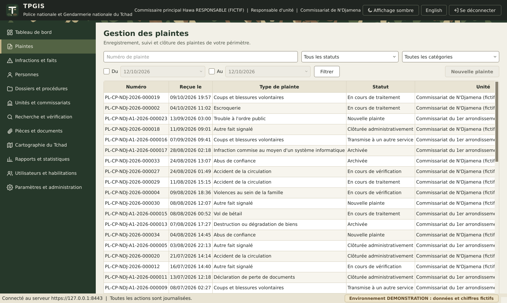
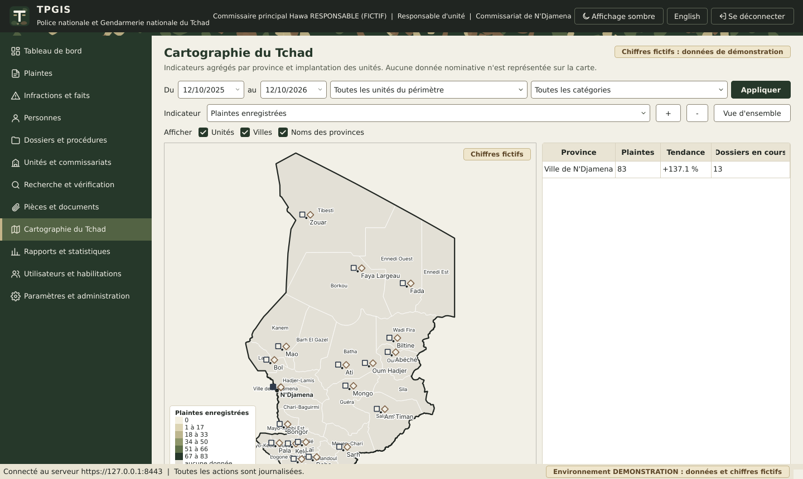

# Guide utilisateur du client TPGIS

Ce guide s'adresse aux personnels habilités de la Police nationale et de la Gendarmerie nationale. Les écrans et boutons disponibles dépendent de votre rôle : un module absent du menu n'est pas accessible avec votre habilitation. Toutes vos actions sont journalisées.

## 1. Connexion

1. Lancez **TPGIS** depuis le menu Démarrer. Le logiciel vérifie d'abord la disponibilité du serveur institutionnel ; en cas d'indisponibilité, un message l'indique et aucune donnée n'est accessible hors ligne.
2. Saisissez votre identifiant et votre mot de passe.
3. Si votre rôle l'exige, saisissez le code à 6 chiffres de votre application d'authentification. Un code ne peut servir qu'une fois.
4. À la première connexion, changez votre mot de passe (12 caractères au moins, trois types de caractères, sans votre identifiant). Si votre rôle impose le second facteur, ajoutez la clé affichée dans votre application d'authentification puis confirmez avec un code.
5. Après 5 échecs, le compte est verrouillé 15 minutes. Une session inactive 30 minutes est fermée ; une session dure au plus 8 heures.

### Langue de l'interface

L'interface existe en français et en anglais. Choisissez la langue dans la liste en haut de l'écran de connexion, ou à tout moment avec le bouton « English » (ou « Français ») du bandeau supérieur, sans vous reconnecter. Votre choix est mémorisé sur le poste. Les documents PDF et le journal d'audit restent en français. Détails : [traduction.md](traduction.md).

## 2. Écran principal

Le bandeau supérieur rappelle votre identité, votre rôle et votre unité, et propose « Affichage sombre » (ou « Affichage clair »), « English » (ou « Français ») et « Se déconnecter ». L'affichage clair est utilisé par défaut ; l'affichage sombre convient aux postes utilisés dans une pièce peu éclairée. Votre choix est mémorisé sur le poste. Hors production, les écrans présentant des chiffres portent la mention « Chiffres fictifs » et la barre d'état rappelle l'environnement utilisé. Le menu latéral donne accès aux modules :

| Module | Usage |
|---|---|
| Tableau de bord | Indicateurs agrégés de votre périmètre, carte du Tchad, évolution mensuelle, répartition par catégorie |
| Plaintes | Enregistrement, suivi, statuts, personnes associées, pièces, fiche et bordereau PDF |
| Infractions et faits | Faits rapportés, vérifiés, soupçonnés ou décisions judiciaires |
| Personnes | Registre des personnes citées, détection des doublons, fiches, biométrie (simulation) |
| Dossiers et procédures | Ouverture, actes, plaintes rattachées, clôture |
| Unités et commissariats | Référentiel des unités |
| Recherche et vérification | Recherches exactes et par identité, avec finalité obligatoire |
| Pièces et documents | Accès aux pièces d'une plainte ou d'un dossier par son numéro |
| Cartographie du Tchad | Agrégats par province, implantation des unités, filtres |
| Rapports et statistiques | Statistiques détaillées, exports CSV et PDF |
| Utilisateurs et habilitations | Comptes, rôles, permissions (administration) |
| Journal d'audit | Consultation des traces (auditeurs) |
| Paramètres et administration | Mon compte, demandes de double validation, référentiel, paramètres, conservation, supervision |

## 3. Enregistrer une plainte

1. Module **Plaintes**, bouton **Nouvelle plainte**.
2. Renseignez la date de réception (par défaut maintenant), le service d'enregistrement, l'unité concernée, le type de plainte et la **description des faits allégués** (10 caractères au moins). La date et le lieu des faits peuvent rester inconnus.
3. **Associer une personne** : recherchez une fiche existante ou créez une nouvelle personne, puis choisissez son **rôle procédural** (plaignant, victime, témoin, personne mise en cause, personne citée, autre). Une personne mise en cause reste présumée innocente : le rôle n'est pas une qualification pénale.
4. **Enregistrer** : le numéro unique (par exemple `PL-CP-NDJ-2026-000123`) est attribué automatiquement.
5. Ouvrez la plainte par double clic pour : modifier, changer le statut, associer une personne, déposer des pièces, consulter l'historique, produire la **fiche de plainte** ou le **bordereau de transmission** en PDF.

**Statuts** : nouvelle plainte, en cours de vérification, en cours de traitement, transmise à un autre service (service destinataire obligatoire), clôturée administrativement (motif obligatoire et habilitation spécifique), archivée. Si quelqu'un a modifié la plainte entre temps, l'enregistrement est refusé : rechargez la plainte avant de recommencer.

## 4. Personnes et doublons

1. Les informations inconnues restent vides ; ne saisissez que ce qui est nécessaire à la procédure.
2. Lors de la création, si des fiches proches existent, une fenêtre présente chaque candidat avec son **niveau de correspondance** (exacte, élevée, moyenne, faible), les attributs concordants et les ambiguïtés. Une concordance de nom seule est toujours faible : l'homonymie est fréquente. Choisissez **Utiliser la fiche sélectionnée** ou **Créer une nouvelle fiche malgré tout**.
3. **Ouvrir la fiche** demande la **finalité** de la consultation, enregistrée dans le journal d'audit avec un identifiant de trace affiché en tête de fiche.
4. **Demander une fusion** : sélectionnez la fiche à conserver puis la fiche à absorber, justifiez. La fusion n'est exécutée qu'après approbation par un second responsable.

## 5. Biométrie (mode simulation)

L'onglet **Biométrie** de la fiche personne n'est visible qu'avec l'habilitation correspondante. Dans cette version, **aucune empreinte réelle n'est capturée** : l'adaptateur simulé produit des références synthétiques. Seule la vérification une à une (une capture enregistrée de la personne) est possible ; la recherche biométrique dans la base est désactivée. Toute capture exige un fondement juridique et l'indication du consentement ; sa suppression passe par une double validation.

## 6. Faits, dossiers et pièces

1. **Faits** : précisez toujours la **nature de l'information** (fait rapporté, fait vérifié, soupçon, décision judiciaire). Une décision judiciaire doit citer la référence de l'acte de la juridiction.
2. **Dossiers** : ouvrez un dossier en indiquant les numéros des plaintes à rattacher ; ajoutez les actes (procès-verbaux, auditions, réquisitions) ; la clôture, l'archivage et la réouverture exigent un motif et l'habilitation correspondante. Les enquêteurs ne voient que les dossiers qui leur sont attribués.
3. **Pièces** : formats acceptés PDF, PNG, JPEG, TIFF, DOCX (sans macro), ODT, TXT ; 20 Mo par défaut. Chaque pièce est analysée par l'antivirus : une pièce non confirmée saine reste indisponible. Le dépôt d'une nouvelle version conserve les précédentes.

## 7. Recherche et vérification

1. Choisissez ou saisissez la **finalité** (obligatoire).
2. Renseignez un ou plusieurs critères : numéro de plainte, numéro de dossier, identifiant interne, nom et prénoms, date et lieu de naissance, référence de document.
3. Les résultats indiquent le niveau de correspondance, les attributs concordants et les ambiguïtés, ainsi que l'identifiant de trace d'audit et l'horodatage de la recherche. Les dossiers liés ne sont consultables que s'ils relèvent de votre périmètre. L'extension au périmètre national exige une habilitation spécifique.

## 8. Carte, statistiques et exports

1. Les filtres (période, unité, catégorie) s'appliquent avec **Appliquer**. Les valeurs sont calculées sur les données réellement enregistrées dans votre périmètre.
2. La carte présente des agrégats par province (plaintes, dossiers en cours, tendance par rapport à la période précédente) et l'implantation des unités (carré : Police ; losange : Gendarmerie ; marqueur creux : hors de votre périmètre). Molette pour zoomer, glisser pour déplacer, survol pour le détail. Aucune personne n'y figure.
3. **Exports CSV et PDF** (module Rapports) : réservés aux utilisateurs autorisés, ils demandent une confirmation de votre identité et sont tracés.

## 9. Bonnes pratiques

1. Ne communiquez jamais votre mot de passe ni vos codes.
2. Verrouillez votre poste (Windows + L) dès que vous le quittez.
3. Les fichiers exportés contiennent des informations à diffusion restreinte : enregistrez les sur les supports autorisés uniquement.
4. Signalez immédiatement à l'administration toute anomalie (message de certificat, verrouillage inexpliqué, données incohérentes).
